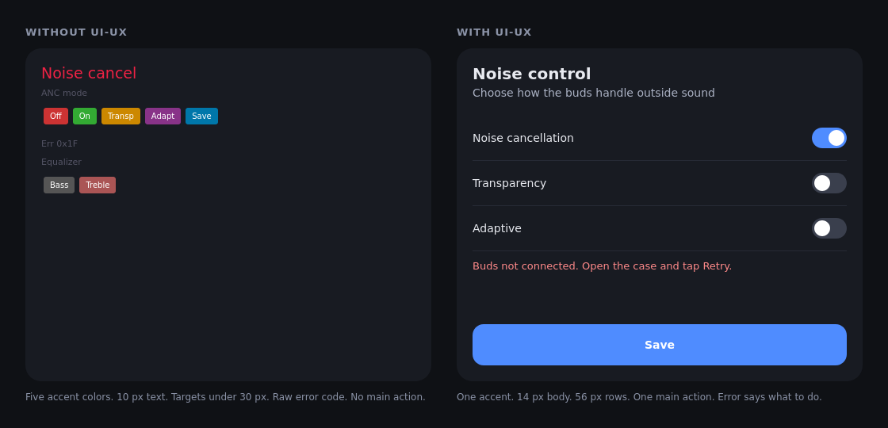
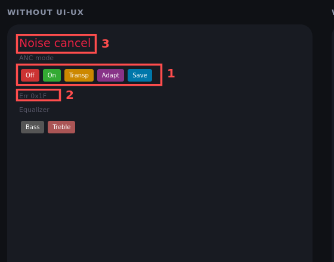

# skills

**Small instruction files that make Claude Code write less code, shorter answers and more consistent UI.**

A *skill* is a folder with one file, `SKILL.md`. The file holds rules in plain text. Claude Code reads them when a task matches. You do not run a skill: it applies by itself, or (for the two audits) when you type a slash command.

This repo has six skills and an optional status bar. They work in [Claude Code](https://claude.com/claude-code) and in [DeepSeek Harness](https://github.com/deepseek-ai/deepseek-harness). Each skill is independent: install only the ones you want.

## Quick start

```sh
git clone https://github.com/spizganed/skills.git
mkdir -p ~/.claude/skills
cp -r skills/{yagni,ooga-bogga,asd-ste100,ui-ux,audit-repo,audit-ui} ~/.claude/skills/
```

Restart Claude Code. Then try it:

- Ask for a small feature. With `yagni`, Claude changes only what the task needs.
- Ask any question. With `ooga-bogga`, the answer comes first, with no filler.
- Type `/audit-repo`. Claude audits your repo and edits nothing.

## The six skills

| Skill | When it applies | What it changes |
|---|---|---|
| [`yagni`](yagni/SKILL.md) | Every coding task | Builds only what the task needs. Reuses existing code. Fixes the cause, not the symptom. |
| [`ooga-bogga`](ooga-bogga/SKILL.md) | Every chat reply | Gives the answer first. Cuts filler, pleasantries and recaps. |
| [`asd-ste100`](asd-ste100/SKILL.md) | Every writing task | Writes docs, commits and comments in Simplified Technical English. |
| [`ui-ux`](ui-ux/SKILL.md) | UI work: screens, themes, layouts, animation | Copies sibling screens, uses shared tokens, builds every state. Android first (Material 3), also iOS and web. |
| [`audit-repo`](audit-repo/SKILL.md) | Only when you type `/audit-repo` | Audits a repo for bugs, doc errors and sensitive data. Edits nothing. |
| [`audit-ui`](audit-ui/SKILL.md) | Only when you type `/audit-ui` | Audits a UI against the `ui-ux` rules. Edits nothing. |

The first four shape how Claude works. The last two are tools you start yourself.

## What each skill does, with an example

### yagni: "you aren't gonna need it"

Models like to add more than you asked: a config option, a helper class, error handling for cases that cannot happen. `yagni` stops that.

- Read the task and trace the real flow first.
- Look for the thing in the codebase, the standard library and installed dependencies before adding a dependency.
- Write the smallest change that works. No abstraction or flag for one use.
- When unsure, pick the simple default and say in one line what you left out.

*Example.* You ask "add a button that clears the list". Without the skill you may get a new `ClearStrategy` interface and a settings flag. With it you get one button and one function call.

### ooga-bogga: terse chat replies

- Lead with the result, then the next step.
- Remove "sure!", "great question", "just", "basically" and recaps of what was done.
- Keep articles and words like "not" and "never". Clarity beats brevity.
- The skill turns itself off for security warnings, irreversible actions and unclear step order.
- It applies to chat only. Docs and commits stay in normal prose.

*Example.* "Sure! I'd be happy to help. It looks like the build failed because…" becomes "Build failed: `JAVA_HOME` is not set. Set it to JDK 21."

### asd-ste100: Simplified Technical English

[ASD-STE100](https://www.asd-ste100.org/) is a writing standard from aerospace manuals. It makes text easy to read, also for people who read English as a second language.

- One idea per sentence, 20 words or fewer. Active voice, present tense.
- One term for one thing. Simple verbs: "use", not "utilize".
- State the current fact. Give a past mistake one line: "Was: X. Is: Y."

*Example.* "The configuration file may be modified by the user in order to enable the feature" becomes "Edit the config file to enable the feature."

### ui-ux: consistent screens

- Name the one job of the screen. Make that action the most visible.
- Read two sibling screens and copy their spacing, type and colours. Use shared tokens, never a literal value.
- Define each animation once by role (press, toggle, screen enter) and reuse it.
- Build every state: default, pressed, focus, disabled, loading, empty, error.
- Follow the platform: Material 3 on Android, the HIG on iOS. The values are in [`ui-ux/references/platforms.md`](ui-ux/references/platforms.md).
- Contrast of 4.5:1 or more. Touch targets of 48 dp (44 pt on iOS). Text that grows to 200 percent.



The source of this picture is [`examples/mock.html`](examples/mock.html).

### audit-repo: a read-only review

Type `/audit-repo`. Claude asks which repo, branch and whether to scan the git history. Then it reads every tracked file and checks for bugs, secrets, personal data, broken links and stale facts.

- Output: one finding per line, sorted by severity, each with a fix marked **safe** or **risky**.
- It edits nothing until you approve a fix.

### audit-ui: a UI review with evidence

Type `/audit-ui`. Claude looks at screenshots or a running app and checks them against the `ui-ux` rules.

- **Quick** (default): at most 6 images of one screen: light, dark, 200 percent text, empty, error, keyboard. Add `full` for the whole matrix.
- Cheap checks first. On Android, [whiskerADB](https://github.com/spizganed/whiskerADB) `pp audit` finds small touch targets and unlabeled controls with no image.
- Findings cite measured values, for example `contrast 3.1:1, needs 4.5:1`.
- It edits nothing until you approve a fix. Then it captures again to confirm.



The full report is [`examples/audit-ui-report.md`](examples/audit-ui-report.md). It comes from an earlier, deeper version of the audit; the format is the same.

## Status line (optional)

[`statusline/`](statusline/README.md) is not a skill. It is a script for the Claude Code status bar. It shows which skills are active, your 5 h and 7 d usage limits, the model and the context use. The folder has manual steps and a prompt that tells an agent to install it.

## Install in detail

### Claude Code

Copy the skill folders you want into `~/.claude/skills/`. Restart Claude Code. To update, run `git pull` and copy again. To remove a skill, delete its folder.

For one project only, copy the folders into `.claude/skills/` inside that project.

### DeepSeek Harness (dsh)

The `SKILL.md` files work in dsh with no change. Run the installer:

```sh
git clone https://github.com/spizganed/skills.git
skills/dsh/install.sh
```

- dsh has no switch that loads a skill in every session. The installer puts `yagni`, `ooga-bogga` and `asd-ste100` into `~/.dsh/AGENTS.md`, which every session reads.
- It copies `ui-ux`, `audit-repo` and `audit-ui` to `~/.dsh/skills`. dsh loads `ui-ux` on UI work. The audit skills load only on `/audit-repo` and `/audit-ui`.
- It replaces only its own block in `AGENTS.md`. Your other lines stay.
- `DSH_HOME` sets another dsh home. To update, run `git pull` and the installer again.

Tested with dsh 0.2.1-rc.2.

## How a skill loads

Claude reads only the `description` line in the front matter of each `SKILL.md`. It loads the full file when the description matches the task. So an installed skill costs almost no context until it is used.

`audit-repo` and `audit-ui` set `disable-model-invocation`: they never load on their own. Only the slash command starts them.

## Questions

**Do `ooga-bogga` and `asd-ste100` conflict?** No. `ooga-bogga` shapes chat replies. `asd-ste100` shapes everything written to files.

**Can I change the rules?** Yes. A skill is a text file: edit it. Keep the `description` line short and exact, because it decides when the skill loads.

**Why would I want terse replies and plain English?** Shorter output costs fewer tokens and is faster to read, especially on a phone screen.

**Does it work with other agents?** The format is plain Markdown with a small header. Any agent that reads `AGENTS.md` can use the rules: paste them in. The `dsh` installer does this for DeepSeek Harness.

## License

MIT. See [LICENSE](LICENSE).
